# Survey Workspace: UgCS Capability Alignment and RGCS Interaction Design

- **Language:** English | [简体中文](ugcs-survey-workspace-plan.zh-CN.md)
- **Review date:** 2026-10-25
- **Status:** Proposed design and implementation sequence; application changes have
  not been implemented by this review.
- **Execution hold:** Await the owner's review. Do not start any SW work package
  until implementation is explicitly authorized.
- **Updated execution order:** Follow the [architecture-first master plan](architecture-first-delivery-plan.md).
  Its sequence and combined-program estimate supersede the earlier ordering here;
  Flight Plan/Drape move to the final feature phases. SW IDs remain scope references.
- **Operating baseline:** [UgCS Survey operations](../ugcs-survey-operations-baseline.md).
- **Visual concept:** [Survey workspace](ugcs-survey-workspace-concept.svg).
- **Navigation concept:** [Engineering menus and top bars](ugcs-survey-navigation-concept.svg).
- **Tool architecture:** [Independent tools and shared runtime](tool-module-architecture-plan.md).
- **Existing roadmap:** [Lifecycle, survey, and HRDEM plan](lifecycle-survey-hrdem-plan.md).

**Review guide:** menu/layout decisions are in §4.7–4.14; resource estimates in
§11; Flight Plan/Drape/Execution/Monitor boundaries in §12. The companion tool
architecture covers operation ownership in §5 and demand loading in §11.

## 1. Product direction

**Match the UgCS Survey capabilities in the operating baseline, using an RGCS-native,
line-oriented workspace.** The target includes route composition, area/corridor
planning, payload-derived grids, terrain behavior, actions, route variants,
execution, and battery-change continuation.

The user-facing hierarchy is **task → segment → measurement line → compiled
waypoint**. The operator normally edits a meaningful segment or line. Compiled
waypoints remain inspectable and editable through an explicit override mechanism.

RGCS's identity comes from four linked capabilities:

1. **Line-first measurement planning:** primary, tie, and calibration lines retain
   their identity through generation, flight sessions, and review.
2. **Map/profile/inspector linkage:** selecting a line or a reported issue locates
   the same object in all three views.
3. **Traceable terrain and mission revisions:** the source datum, DEM, planned
   heights, compiled commands, and aircraft read-back refer to identifiable inputs.
4. **Measurement continuity:** battery sorties contribute to the same survey task,
   with explicit incomplete-line and reflight handling.

The initial delivery can prioritize the existing `UavMag` profile. Photogrammetry
and LiDAR-specific capabilities remain explicit parts of the parity target and
the work breakdown below. Supported execution choices are resolved against the
target aircraft: a DJI turn-mode label or a rangefinder option must have a real
PX4 execution contract before being presented as supported.

## 2. Existing implementation to build on

| Existing element | Evidence | Design use |
| --- | --- | --- |
| Five stages: Prepare / Plan / Preflight / Fly / Review | `App.tsx`, `RightInspector.tsx`, `survey_profile/mod.rs` | Preserve the top-level workflow and stage-specific surfaces. |
| Cesium map + right inspector + bottom profile drawer | `App.tsx`, `RightInspector.tsx`, `ProfileDrawer.tsx` | The workspace's physical layout. |
| Area / Pattern / Waypoints / Sync guided planning | `panels/plan/PlanSteps.tsx` | Reuse for initial task creation and field editors. |
| Polygon/rectangle, sweep, tie lines, lead-in/out, alternate directions, cloverleaf | `survey/pattern.rs`, `PatternStep.tsx` | Existing survey primitives, not new feature claims. |
| Saved presets, undo/redo, WMM2025 field alignment | `PatternStep.tsx`, `stores/mission.ts` | Promote into persistent task recipes and semantic edit history. |
| DEM preparation, height conversion, drape solver/compiler | `terrain_service.rs`, `core/terrain`, `core/height` | Authoritative terrain and altitude calculations. |
| Planned, per-line drape, and live profile components | `AltitudeProfile.tsx`, `DrapePreview.tsx`, `LiveAltitudeProfile.tsx` | One linked profile surface with several data views. |
| Plan summary, issue-to-field navigation, upload/read-back hashes | `PlanSummary.tsx`, `readiness.ts`, `stores/mission.ts` | Extend current feedback to segments, lines, and immutable revisions. |
| Project, survey, session records; recorder and project archives | `core/project`, `core/recorder`, `core/archive` | Persist task definitions and later associate executed sorties. |
| Shared typography, colors, density, and field themes | `design-system/index.css` | Reuse Inter, JetBrains Mono, semantic tokens, and outdoor modes. |

The current inspector is 288 px wide. A dense per-line plot is currently rendered
inside it, while the map's bottom drawer is used for the live profile. The design
gives terrain comparison a wider shared surface and makes the inspector contextual.

## 3. Capability alignment matrix

“Foundation” means useful code exists; it does not mean the complete UgCS operation
is already available. BL IDs refer to the independent operations document.

| Baseline | Current RGCS foundation / gap | Target experience | Work packages |
| --- | --- | --- | --- |
| BL-01 Task/route/profile | Project and Survey models exist; the active editor is mostly one flattened plan. | Task selector with aircraft, payload recipe, named plan revisions, and flight sessions. | SW-06, SW-08 |
| BL-02 Area geometry | Polygon/rectangle editing exists; native KML/CSV AOI workflow needs expansion. | Draw, import, translate, rotate, edit vertices; show area and validity immediately. | SW-08, SW-10 |
| BL-03 Ordered segments | `lastPattern` tracks the latest generated block; edits discard its provenance. | Insert/reorder/duplicate typed segments and preserve their parameters. | SW-03, SW-06 |
| BL-04 Area Scan inputs | Spacing, azimuth, height, speed, and direction controls exist. | The same direct inputs, a live preview, and an explicit generated-result revision. | SW-01, SW-04, SW-08 |
| BL-05 Payload/GSD/overlap | Native camera-derived planning is absent from the reviewed Sweep/Cloverleaf editor. | Payload profile drives GSD, overlap, footprint, trigger interval, and image estimates. | SW-09 |
| BL-06 Altitude modes | Relative/AMSL/AGL/terrain exist; datum boundaries need correction. | Explicit Home-relative, AMSL, vertical AGL, and surface-distance behavior; capability-resolved rangefinder choice. | SW-02, SW-05, SW-07 |
| BL-07 Tolerance/smoothing | Drape tolerance and rate constraints exist; some inputs are hard-coded. | Separate target band, waypoint approximation, slope/gap smoothing, and their effects on point count. | SW-04, SW-07 |
| BL-08 Turns/overshoot | Lead-in/out exists; full turn policy and independent overshoot speed need implementation. | Editable turn/transition segments with aircraft-backed speed and curvature behavior. | SW-01, SW-07 |
| BL-09 Entry/Home/end | Individual mission points exist; semantic entry and endpoint composition is incomplete. | Drag takeoff/landing; select nearest/manual entry and direction; display Home independently. | SW-06, SW-07 |
| BL-10 Actions | Wire commands and optional trigger compilation exist; UI uses GCS-side magnetic segmentation. | Ordered action list with Every point / At start / Measurement passes / last-point behavior. | SW-03, SW-09 |
| BL-11 Summary/profile | Several summaries/plots exist but do not share one complete compiled-route contract. | One recomputed mission summary and linked whole-route/per-line profile. | SW-04, SW-07, SW-08, SW-11 |
| BL-12 Route variants | Project storage and presets provide a foundation. | Duplicate/name/hide variants; compare geometry and summary changes against a chosen revision. | SW-06, SW-08 |
| BL-13 Double grid/oblique | Parallel/tie geometry is reusable; capture semantics need a dedicated mode. | Double-grid control plus independent camera attitude and capture policy. | SW-09 |
| BL-14 Map/DEM resources | Local DEM/mesh, providers, provenance and preparation exist. | Resource drawer with ordered sources, coverage, DTM/DSM role, datum, age, and offline status. | SW-02, SW-08, SW-10 |
| BL-15 Constraints/partial calculation | Per-line drape checks exist; target limits and full-route checks are incomplete. | Locate each violation; explicitly distinguish complete, partial, and failed calculation. | SW-05, SW-07 |
| BL-16 Transfer/execution | Upload/download, read-back, flight modes, and telemetry exist. | Immutable transfer snapshot; verified aircraft revision and visible execution progress. | SW-04, SW-05 |
| BL-17 Battery continuation | `set_current` is a primitive; the survey execution ledger remains deferred. | Resume interruption, selected line/waypoint, or task start with a previewed entry path. | SW-11, SW-12 |
| BL-18 Interchange | QGC `.plan` handling and unknown-field preservation exist. | Explicit conversion report for geometry, datum, commands, and unsupported actions; AOI KML/CSV support. | SW-02, SW-10 |
| BL-19 Full-flight terrain | The main drape path processes pattern lines and landing points. | Terrain treatment covers approach, line changes, return, and the path to landing as well. | SW-06, SW-07 |
| BL-20 LiDAR/calibration | Cloverleaf and calibration line kinds exist; native LiDAR recipe needs expansion. | Insert calibration as a typed segment; associate LiDAR survey/corridor and acquisition settings. | SW-06, SW-09 |

Parity is evaluated through the baseline scenarios and target-aircraft behavior.
A control with no implemented effect does not count as functional parity.

## 4. Workspace layout



The concept is a design illustration, not a screenshot of a delivered application.

```text
Global bar: menu / project          aircraft / mode / RTK / battery / Hold / RTL
Task bar: Prepare  Plan  Preflight  Fly  Review | task / revisions / stage action
┌─────────────────────┬────────────────────────────────┬───────────────────────┐
│ Route outline       │ Cesium map                     │ Context inspector     │
│ Takeoff             │ Boundary and direction handles │ Basic | Advanced      │
│ Approach            │ Measurement / tie / cal lines  │ Actions | Checks      │
│ Survey A            │ Entry and end handles          │                       │
│   S01 … S12         │ Issue markers / selected span  │ Fields for selection  │
│ Tie lines           │                                │ Changes / result      │
│ Return / Landing    │                                │                       │
├─────────────────────┴────────────────────────────────┤                       │
│ Profile: Whole route | Selected line | Live           │                       │
│ DTM / DSM / target band / compiled path / actual path │                       │
│ Segment strip + linked cursor + located constraints  │                       │
├──────────────────────────────────────────────────────┴───────────────────────┤
│ Area · lines · full-route ETA · all mission items / target limit · readiness  │
└──────────────────────────────────────────────────────────────────────────────┘
```

### 4.1 Task context and outline

- Keep the existing five-stage model. Expose stages in the task bar when space
  permits and retain the compact Workflow selector at narrow widths. Show the
  active survey task and draft/aircraft revisions beside them.
- Add a collapsible outline over the map's left edge. It lists typed segments in
  flight order, expandable into measurement lines and then compiled points.
- Segment actions: insert before/after, duplicate, move, reverse where meaningful,
  hide in the editor, disable from the plan, and delete. **Hide** and **disable**
  are separate operations.
- Inserting a calibration segment preserves the surrounding survey. Editing an
  endpoint does not discard unrelated pattern parameters.
- Raw point inspection is reached from the selected line or an Advanced entry;
  generation leaves the operator in the Survey editing context.
- Reuse Area/Pattern cards for the empty-task creation flow. The same stored draft
  drives guided creation and later object-based editing.

### 4.2 Context inspector

The inspector renders the selected object rather than an unrelated global form.

| Selection | Primary fields / actions |
| --- | --- |
| Task | Aircraft/profile, survey recipe, default altitude policy, route-end policy, revision/variant operations |
| Area | Boundary source, vertices, translation/rotation, area, coverage, geometry validity |
| Survey segment | Tool type, height/GSD, spacing/overlap, speed, azimuth, entry, double grid where applicable |
| Measurement line | Stable ID, role, length, direction, inherited values, explicit overrides, include/reverse controls |
| Approach/turn/return | Geometry, altitude/clearance policy, speed, terrain coverage, applicable vehicle constraints |
| Waypoint | Coordinates, tagged height, command parameters, lock, source line/segment, override state |
| Issue | Observed value, required limit, source data, affected span, and the field that resolves it |

Use **Basic / Advanced / Actions / Checks** as familiar functional groupings:

- **Basic:** commonly changed fields for the active tool.
- **Advanced:** lead-in/out, overshoot speed, turn policy, smoothing, tolerance,
  tie lines, and tool-specific options.
- **Actions:** ordered payload/heading/wait actions plus their execution scope.
- **Checks:** structured results tied to the current calculation revision.

A magnetic recipe exposes line spacing and tie/calibration controls. A camera
recipe exposes GSD and overlap. A LiDAR recipe exposes its footprint/overlap
requirements. The underlying route composition and interaction model are shared.

### 4.3 Map interactions

1. Select a survey polygon to expose move/rotate, vertex, azimuth, and entry handles.
2. Drag the azimuth arrow or enter an exact angle; preserve a manually locked angle.
3. Move takeoff and inspect the proposed nearest entry; the operator can select
   another entry and reverse the traversal.
4. Click a line to select its stable ID across outline, inspector, and profile.
5. Click an issue marker to select its exact line/along-track span and related field.
6. Show generated points on demand; measurement-line identity remains readable at
   a useful zoom level even when terrain adds many points.
7. Reuse semantic colors: survey accent, tie warning-color family, calibration mag
   color, transit muted/dashed. Use labels and line styles as well as color;
   a warning also has a distinct issue marker.

### 4.4 Unified profile surface

Extend `ProfileDrawer` with Whole route, Selected line, and Live views. Reuse the
existing uPlot rendering and terrain/monitor outputs.

- Draw DTM, DSM, the actual configured clearance floor, target AGL band, designed
  profile, and compiled path. Show actual flight only against its matching baseline.
- The horizontal segment strip identifies Takeoff / Approach / S01 / Turn / S02 /
  Return / Landing. Selecting it selects the same map object.
- A linked cursor reports line ID, along-line distance, tagged altitude, AGL,
  clearance, and data availability at that location.
- Sample the terrain along **all** relevant flight legs. Interpolating endpoint
  ground samples must not be presented as observed terrain between those points.
- A data gap stays visibly unknown. Plot band/floor values come from the same
  calculation result as the inspector; no independent display defaults.
- Show source and revision context: DEM identity, datum, resolution/acquisition
  metadata, and whether the plotted result belongs to the current draft.

### 4.5 Summary and calculation feedback

Expand the existing `PlanSummary` with whole-task area, measurement/transit lengths,
line counts by role, complete mission-item count, ETA, applicable payload output,
and located issues.

After valid parameter edits, debounce calculation using the existing scheduling
approach. During calculation, mark the old result as stale. Explicit Recalculate
remains available. A new result is applied only if its full input revision still
matches. Editing during a transfer creates a new draft while the sent snapshot
retains its identity.

Represent these dimensions independently:

- Calculation: editing / calculating / complete / partial / failed.
- Transfer: unsent / uploading / reading back / verified / mismatch.
- Execution: ready / executing / interrupted / completed, supplied by the session
  implementation when that work is enabled.

### 4.6 Responsive and field layout

- At wide desktop widths, show the outline and a 320–360 px adjustable Plan inspector.
- At 1366×768, use a compact outline and approximately 320 px inspector; allow the
  outline to collapse independently so the map retains useful editing space.
- At 1024×640, open the outline as a drawer/popover and keep one editing surface
  in focus. The profile remains collapsible and resizable.
- Reuse existing light, dark, and night-red themes. Field density enlarges primary
  touch targets to at least 44 px; numeric inputs retain visible labels and units.
- Keep coordinates, heights, limits, and hashes monospaced. Avoid color-only
  status and hover-only information for essential checks.
- Persist the operator's pane sizes and collapse choices; selecting an ordinary
  line does not unexpectedly reopen every pane.

### 4.7 Top workflow and menu assessment

The current code already has useful separation between view navigation and
aircraft commands. Improve visibility and task context on top of that foundation:

| Current observation | Improvement |
| --- | --- |
| `WorkflowNav.tsx` exposes only the current stage until its popover opens; its `2/5` is a stage index, not completion. | Show five clickable stages in the task bar on desktop, with readiness shown separately from the stage number. Keep the keyboard-accessible popover for narrow widths. |
| The preflight badge is visible on the trigger only while Preflight is selected. | Show a compact readiness/issue badge on the Preflight stage while planning too, sourced from the same checklist. |
| Project, Tools, Settings, workflow, status, commands, health, and alerts share one row. | Use a global/status row and a task/stage row. Place task operations beside the task they affect. |
| `TopBar.tsx:132–174` folds both battery and RTK into More at narrow widths. | Keep battery percentage visible at 1366 and 1024 widths. Preserve compact GNSS/RTK state for survey use; move detailed satellite/voltage information into its popover. |
| `SafetyCommands` already keeps Hold/RTL visible. | Retain those direct controls and their existing command semantics at all supported widths. |
| UgCS tutorials repeatedly navigate through Main menu → Profiles/Payloads and Map layers. | Give Resources a discoverable menu entry and a task-local terrain chip that opens the relevant resource tab. |
| `RightInspector.tsx:38–44` starts/stops the drape monitor on Fly-view entry/exit. | Move execution-monitor lifetime to the active flight/baseline lifecycle. Workspace navigation should not stop monitoring or change the flown baseline. |

### 4.8 Two-row navigation proposal

**Global row, approximately 48 px:**

`App menu · Project selector | Vehicle/link · Armed state · Mode · RTK · Battery · Hold · RTL · Commands · Alerts`

**Task row, approximately 40–44 px:**

`Prepare · Plan · Preflight · Fly · Review | Survey selector · Revision status · Resources · Stage action`

- At ≥1440 px, show the five short stage labels and a compact preflight badge.
- At 1100–1439 px, shorten context labels and omit secondary shortcuts first;
  collapse stages to the existing current-stage selector when the measured space
  budget requires it.
- Below 1100 px, use `Plan · 2/5 ▾`, a truncated task name, and the stage action.
  Battery, link/mode, alerts, and Hold/RTL remain reachable without opening More.
- The overflow order is: optional tool shortcuts → long project/task text → expanded
  stage navigation → secondary metadata. Essential aircraft state has priority.
- Stage navigation remains freely selectable. Selecting **Fly** changes the view;
  **Start mission**, **Hold**, and **RTL** are actual commands with their existing
  availability/confirmation/ACK behavior.

Readiness is a separate indicator: for example, Prepare “data ready”, Plan
“calculated”, Preflight “2 issues”, Fly “idle/executing”, Review “session available”.
Do not infer readiness from which stages the operator has visited.

### 4.9 Menu structure

Use one discoverable application menu, a task menu adjacent to the active survey,
and object actions in the outline/inspector. This follows the useful UgCS
mission/profile/resource concepts while reusing RGCS's existing tool windows.

```text
Application menu
  Project             New / Open / Recent / Import / Export
  Resources           Maps / Elevation sources / Aircraft profiles
                      Payload profiles / Survey recipes
  Tools               Parameters / Signal Inspector / Motor test / Flight logs
                      Export diagnostics
  View                Outline / Inspector / Profile / Field mode / Theme
  Settings            Connection / Devices / Application preferences
  Help                Shortcuts / Documentation / About

Survey menu (beside the active task name)
  New survey / Rename / Duplicate / Save as recipe
  Import boundary / Import mission / Export mission
  Compare revisions / Flight sessions / Archive task

Selected segment menu
  Insert before / Insert after / Duplicate / Reorder
  Move / Rotate / Reverse traversal where applicable
  Show compiled points / Edit actions / Reset overrides
  Hide in editor / Include in mission / Delete
```

Context labels make the affected object explicit: Export project, Export mission,
Delete segment, Clear local draft, and Clear aircraft mission are distinct commands.
Menu, shortcut, and contextual entry share the same action and availability
descriptor; they must not introduce separate implementations or open duplicate
tool windows. Reuse the existing tool-status/focus behavior and Radix popovers.

### 4.10 Stage-specific actions

| Stage | Main task action | Secondary actions |
| --- | --- | --- |
| Prepare | Prepare survey data | Import boundary, choose resources/profile, inspect coverage |
| Plan | Review & upload the current calculation | Recalculate, compare revision, export |
| Preflight | Start the verified mission through the aircraft adapter | Open located issues, inspect aircraft mission |
| Fly | Show the active session/line and command progress | Existing Hold/RTL/Commands controls; continuation once SW-12 is enabled |
| Review | Open/export the session report | Compare planned/actual paths; select reflight lines once SW-13 is enabled |

During an active flight, the task bar identifies the executing snapshot even if the
operator opens Plan or Review. Draft edits, the plotted preview, and the aircraft's
active mission remain separately identifiable.

### 4.11 Elevation-source entry and the UgCS default

The current UgCS manual identifies **SRTM** as its built-in elevation source, with
**WGS84 / EPSG:4326** horizontal coordinates and **EGM96** vertical datum. It supports
custom DEM/DTM/DSM sources and source ordering. The cited manual does not establish
one universal built-in resolution, so the UI must show the actual selected source's
metadata rather than assume 1 m. See baseline D05 for import/datum details.

RGCS's Resources → Elevation drawer should show, per source:

`Name/source · DTM/DSM role · resolution · acquisition date · horizontal CRS · vertical datum · coverage · priority · offline availability`

The task-local chip can read `Terrain · HRDEM 1 m · Ready` or `Terrain · Coverage
missing`. Its details show the input datum and the verified conversion to the
mission's working datum. Display imagery and elevation as separately named resource
tabs so changing a basemap cannot imply that the planning elevation source changed.

### 4.12 Engineering usability and visual discipline

The intended aesthetic is a calm, precise engineering workstation. Its visual
hierarchy follows the operator's decisions: **task → selected object → inputs →
calculated evidence → execution state**.

| Principle | Concrete specification |
| --- | --- |
| Stable controls | Aircraft commands and important health remain in fixed positions; menu opening and stage switching do not move Hold/RTL. |
| Explicit scope | Titles show the current task/segment/line; commands use a verb and object, such as Export mission or Delete segment. |
| Numerical clarity | Value, unit, datum/reference, and source are available together. Zero, Unknown, Stale, and Not applicable have distinct presentation. |
| Restrained color | Neutral working surfaces; accent for selection/primary action; severity colors for conditions. Line roles also use IDs and line styles. |
| Coherent density | 4/8/12/16 px spacing rhythm, aligned section edges, approximately 32 px regular rows/controls and ≥44 px primary field-mode touch targets. |
| Readable hierarchy | Main labels around 14 px; supporting labels generally ≥12 px; monospaced numerical columns. Avoid truncating units or essential command labels. |
| Quiet containers | Prefer shared panels and light separators over many nested cards. Small consistent corner radii; shadows identify overlays, not every control. |
| Map prominence | Subdue basemap contrast when needed; make selected lines and problem spans legible without turning every point into a permanent label. |
| Action economy | One clear stage-specific primary action; secondary commands are adjacent or in the correctly scoped menu. |
| Traceable edits | Show inherited/overridden values, calculation age/revision, and a concise before/after summary for consequential edits. |

Reuse the repository's design tokens rather than adding an independent visual
theme. The diagrams use the current dark palette as an illustration; light/field
and night-red versions must preserve the same hierarchy and contrast relationships.

### 4.13 Practical operator journeys

Validate the layout against complete engineering tasks:

1. **Office preparation:** import AOI → select resources/recipe → set line direction
   and spacing → compare route variants → inspect complete terrain/constraint result.
2. **Arrival on site:** identify actual aircraft/Home → adjust takeoff/landing →
   regenerate approach/return → inspect changed heights and duration → upload/read back.
3. **Resolve an issue:** click the issue count → select the affected span on map
   and profile → edit the responsible field → see a new calculation revision.
4. **Battery continuation:** identify incomplete line → choose restart/entry policy
   → inspect repeated/remaining coverage → execute the next identified sortie.
5. **Review:** select a flown session → compare its frozen plan with actual data →
   inspect provenance/line outcomes → export or prepare a reflight.

The [navigation concept](ugcs-survey-navigation-concept.svg) shows menu contents as
separate example states, not as several popovers that must remain open together.

### 4.14 Menu consolidation checklist

The first UI review should settle this concrete reduction of the current clutter:

| Existing entry / ambiguity | Proposed placement / treatment |
| --- | --- |
| Adjacent Tools, Settings icon, and wide-screen tool launchers | Put Tools and Settings in the application menu; any retained wide-screen tool shortcuts reuse those actions and yield space first. |
| Workflow beside aircraft mode and Flight controls | Move workflow to the task row; keep aircraft mode in the global status row. Label the existing Flight popup **Commands** to distinguish it from the **Fly** workspace. |
| Task import/export buried in the Sync card's overflow | Expose task-scoped import/export in the Survey menu; retain Upload as the relevant stage action. |
| Similar-looking clear/delete entries | Use explicit names and scopes: Clear local draft, Clear aircraft mission, Delete segment. Put aircraft-mission operations in a named submenu showing the target aircraft. |
| Live events and downloadable log files both called logs | Label the live surface Alerts & events and the tool Flight logs; retain their existing underlying components. |
| Map, DEM preparation, and profile entry points scattered across surfaces | Resources is the stable global entry; the task's terrain/profile chips open that same resource view at the relevant section. |
| Aircraft profile versus live FC parameter editing | Describe Aircraft profile as planning capabilities/limits, and Parameters as the connected flight controller's settings. |
| Many bordered controls at equal visual weight | Use text/quiet buttons for navigation, compact status readouts, and a single emphasized stage action. |

Split SW-14 into **SW-14A: menu/layout shell** and **SW-14B: task-context and
monitor-lifecycle integration**. The menu/layout proposal can be reviewed first;
the execution-related integration retains its SW-04/SW-06 dependencies. Both remain
on hold until the owner authorizes implementation.

## 5. RGCS-specific workflow improvements

### 5.1 A measurement recipe, not a repeated form-filling exercise

Expand the existing presets into versioned task recipes: aircraft/payload
association, survey geometry defaults, altitude policy, tie lines, calibration,
actions, and return behavior. Keep a visible distinction between recipe defaults
and task/line overrides.

Promote the existing **Align ∥ B** action into the magnetic recipe. Offer exact
manual direction and a long-edge helper alongside it. Direction comparison shows
changes in transit length, turns, item count, and ETA; it does not silently replace
an operator's required survey azimuth.

### 5.2 Whole-flight preview with separate acquisition roles

Compose the complete flight explicitly:

`Takeoff → Approach → Calibration → Lead-in → Survey/Tie → Turns → Return → Landing`

Every leg gets terrain/constraint treatment according to its role. Planned return
geometry and the flight controller's emergency RTL behavior are tracked separately.
For continuous magnetic acquisition, transit data remains recordable while its
measurement classification is explicit. Camera trigger gating is a payload policy,
not an assumption applied to every sensor.

### 5.3 Line-aware battery continuation

The continuation panel preserves the baseline choices and adds measurement context:

```text
Continue survey — next sortie
Completed: S01–S08     Interrupted: S09, 234 / 610 m

Resume source: interruption | selected line | selected waypoint | task start
Line policy:   continue remaining part | repeat interrupted line
Entry:         through planned first point | explicit direct/re-entry path

Preview: takeoff → validated approach → lead-in → resumed survey → return
Report: repeated distance, remaining coverage, ETA + return allowance
Context: new aircraft/Home/height anchor, plan revision, uploaded revision
```

Completion is derived from an execution ledger and later QC, not from a single
`MISSION_CURRENT` integer. Repeated/out-of-order telemetry, waypoint changes,
reconnections, and aircraft restarts must preserve honest progress. A reflight is
another session of the same task, retaining source line identities.

### 5.4 Reproducible review

Reuse recorder/project/archive infrastructure. Associate each flown snapshot with
the task, source lines, DEM/datum chain, aircraft parameters, actions, and any
incomplete/repeated spans. Extend the existing drape monitor into later line QC
without duplicating its deviation calculations.

Full session/QC work has existing roadmap dependencies; see section 8.

## 6. Model and code integration

### 6.1 Persisted model

Keep the existing Project → Survey → Session organization. Evolve the Survey's
planning payload to contain ordered semantic segments and revisions. Proposed
contracts to review before implementation:

| Contract | Responsibility |
| --- | --- |
| `SurveyDraft` | Persistent geometry, recipe, aircraft/payload references, ordered segments, and explicit overrides |
| `SurveySegment` / `LegRole` | Stable segment identity and takeoff/transit/survey/tie/calibration/turn/return/landing role |
| `LineId` / source map | Stable measurement identity separate from generated MAVLink sequence numbers |
| `CalculationRevision` | Fingerprint of geometry, parameters/actions, DEM/datum-chain versions, and relevant capabilities |
| `MissionPreview` | Full-route geometry, sampled profiles, summary, complete/partial status, and located issues |
| `CompiledMissionSnapshot` | Immutable wire items, source map, target identity, compilation/height-anchor context, and hash |
| `PlanSelection` | Selected segment/line/waypoint/span shared by map, outline, inspector, and profile |
| `SurveyExecution` | Later session ledger for interruption/completion/reflight; depends on the existing deferred M1 work |

These are design contracts, not new types claimed to exist. Absolute core heights
continue using `height::Height`. Keep vertical-datum conversion, estimator-anchor
compensation, and Home-relative encoding as distinct operations with recorded inputs.

### 6.2 Calculation and execution flow

```text
SurveyDraft + resources + aircraft capabilities
  → generate semantic survey segments/lines
  → compose approach, turns, return, and endpoints
  → sample/solve/simplify terrain across the composed route
  → validate geometry, actions, limits, and data coverage
  → MissionPreview + CompiledMissionSnapshot
  → render / export / upload the identified result
  → verify aircraft read-back against the sent snapshot
  → associate execution events with source lines
```

All numerical route/height/constraint authority remains in Rust. The React stores
own draft interaction and render the returned result. This removes the need for
separate frontend approximations to claim the same terrain or readiness result.

### 6.3 Reuse map

| Area | Existing paths | Proposed extension |
| --- | --- | --- |
| Application shell | `frontend/src/App.tsx`, `components/RightInspector.tsx`, `components/ProfileDrawer.tsx` | Mount the outline/context strip and shared profile; preserve existing stages. |
| Navigation/menus | `components/TopBar.tsx`, `components/WorkflowNav.tsx`, `components/topbar.css`, `components/FlightMenu.tsx`, `components/SafetyCommands.tsx`, `stores/ui.ts` | Two-row hierarchy, responsive stage navigation, discoverable resources, shared menu actions, persistent essential health. |
| Survey editor | `components/panels/plan/PlanSteps.tsx`, `AreaStep.tsx`, `PatternStep.tsx`, `WaypointsStep.tsx` | Share persistent draft fields between creation and contextual editing; add `SurveyOutline` and `SurveyInspector`. |
| Summary/issues | `PlanSummary.tsx`, `mission/readiness.ts`, `stores/preflight.ts` | Revision-aware located issues and full-task facts. |
| Selection/rendering | `stores/mission.ts`, `stores/polygon.ts`, `components/MapView.tsx`, `hooks/useCesiumViewer.ts` | Typed selection/source-map integration and semantic edit history. |
| Profiles | `AltitudeProfile.tsx`, `DrapePreview.tsx`, `LiveAltitudeProfile.tsx`, `mission/profile.ts` | Shared profile data contract and linked cursor. |
| Geometry/compilation | `crates/core/src/survey`, `crates/core/src/plan`, `crates/core/src/terrain` | Typed segments, payload generators, complete-route compilation and checks. |
| Desktop adapters | `crates/app-tauri/src/terrain_service.rs`, `crates/app-tauri/src/commands.rs` | Return/apply identified previews; accept immutable transfer snapshots. |
| Transfer | `frontend/src/mission/compile.ts`, `mission/planfile.ts`, `stores/mission.ts`, `crates/core/src/mission` | One altitude/action contract, immutable upload identity, explicit interchange report. |
| Task/session storage | `crates/core/src/project`, `survey_profile`, `recorder`, `archive` | Reuse existing storage; add execution/QC data through their roadmap dependencies. |

Frontend component paths in the table are relative to `frontend/src` where the
prefix is omitted. New component/type names are proposals.

## 7. Correctness findings that precede expanded functionality

These are findings from the inspected working-tree snapshot, not new SITL or field
measurements. Fix them as small, separately verified changes.

| ID | Observed code fact | Consequence / required verification |
| --- | --- | --- |
| F01 Speed encoding | `terrain/drape_compile.rs:170` emits `[speed, 0, 0, 0]`; `survey/generate.rs:159` emits `[1, speed, -1, 0]`. PX4 v1.17 `navigator_main.cpp:690` reads speed from `param2` and resets it when zero. | Drape's speed command does not request its modeled speed. Also remove the fixed `ground_speed_mps: 5` in `stores/mission.ts:993` in favor of the actual recipe/leg speed. |
| F02 Datum boundary | `terrain_service.rs` returns converted AMSL `preview.waypoints` and retains DEM-datum `result.compiled`. `stores/mission.ts:1029` merges `preview.result.compiled`. | The stored-AMSL contract can receive DEM-datum heights. Review conversion together with the existing anchor compensation; quantify behavior with nonzero datum offsets and with/without an anchor. |
| F03 Line identity | `drapeApply.ts` returns line ranges identified only by kind; `stores/mission.ts:1041` maps them by kind. Multiple survey lines therefore select the same last range. The next input builder also includes every item in the range, including coordinate-less speed items. | Preserve line IDs and filter command items out of sampled geometry; repeat drape over several same-kind lines and verify identity and geometry. |
| F04 Calculation lifecycle | The pre-run key at `stores/mission.ts:1098` includes offset/clearance, while the success key at `:1119` omits them. The stale-result guard uses waypoint geometry rather than the complete parameter/resource revision. | Require idempotent recalculation and rejection of results from older parameter/DEM inputs; settle without a recurring solve loop. |
| F05 Transfer identity | Upload completion at `stores/mission.ts:666–690` recomputes the hash from mutable current state and sets `fcMatches` before asynchronous read-back. | Retain the sent snapshot; report verified only after matching read-back; test edits and anchor changes during transfer. |
| F06 Display truth | `DrapePreview.tsx:52–54` draws DSM + 5 and DTM + 37/+43 regardless of entered values. `mission/profile.ts` interpolates endpoint ground values rather than resampling terrain between them. | Plot the actual configured result and sampled complete route; changes to AGL/clearance must change the displayed band/floor, and an intermediate ridge must be visible. |
| F07 Limits/check facts | `stores/preflight.ts:60–65` uses 65,535 as the limit and supplies null for FC climb limit, battery minutes, and ETA. | Bind the real target capability/profile and fresh parameters. The local PX4 dataman Kconfig defaults to 500 mission items; the board build determines the actual limit. |
| F08 Whole-route scope | `survey/compile.rs` explicitly emits no takeoff/RTL or inter-line transitions; drape compiles survey geometry; `drapeApply.ts` preserves outside-block points. | Add full-route terrain/constraint treatment for approach, changes of line, and return; per-line success is not complete-flight validation. |

`compile.ts` also maps imported terrain-relative heights using a flat Home anchor.
Interchange must explicitly resolve or reject unsupported height references.
Comments in some UI/feature documents still describe the replaced mesh-first drape
path; update those during the relevant correctness work.

## 8. Implementation sequence

### 8.1 Work packages

| WP | Priority | Deliverable | Measurable acceptance | Dependencies |
| --- | --- | --- | --- | --- |
| SW-01 | P0 | Shared validated speed encoding; connect actual segment speed to solver and compiler. | At least two different speeds produce correct `param2` values; target PX4 receives the intended cruise setpoint; invalid values return errors. | F01 |
| SW-02 | P0 | One datum/anchor/import contract across preview, stored plan, export, and upload. | Equivalent CGVD2013/EGM96 fixtures produce identical physical geometry; nonzero datum offset and anchor are each applied once; unknown references are explicit. | F02; existing height chain |
| SW-03 | P0 | Stable source-line mapping through drape, actions, edits, and regeneration. | Three survey lines plus a tie line retain distinct IDs/ranges over repeated regeneration; command points never become `(0,0)` terrain samples. | F03 |
| SW-04 | P0 | Calculation revisions, truthful profile inputs, and immutable upload/read-back snapshot. | Identical inputs settle; delayed old results are discarded; entered bands/floors render exactly; no verified state before matching read-back. | SW-01–03; F04–06 |
| SW-05 | P0 | Aircraft capability/limit adapter and current climb/descent facts. | A final `B+1`-item mission is refused for a target limit B, counting all commands/endpoints; unavailable/stale limits stay unknown; supported actions/frames match PX4. | SW-04; F07 |
| SW-06 | P1 | Persistent task/segment model, composition, variants, and semantic history. | Insert/reorder/duplicate survey and calibration segments; restart/undo preserves inputs and IDs; hiding a segment does not remove it from the mission. | SW-03–04 |
| SW-07 | P1 | Complete-route entry/turn/return planning, terrain sampling, smoothing, and constraints. | Ridge, turn, return, and NoData fixtures are checked across the entire route; partial output identifies omitted spans; target-aircraft trajectory is verified separately from the drawn polyline. | SW-02, SW-05–06 |
| SW-08 | P1 | Outline, contextual inspector, linked map/profile, summary, and field layout. | Selection is consistent across all views; edits persist across stages; no horizontal overflow at the three specified viewports; all BL-related controls have implemented effects. | SW-06–07 |
| SW-09 | P2 | Native corridor/circle, photogrammetry/double-grid/oblique, and LiDAR payload recipes/actions. | Camera/GSD fixtures give expected footprint/spacing/trigger results; action scope survives compilation; supported tools complete the relevant baseline scenarios. | SW-01, SW-06–08; production-profile scope update |
| SW-10 | P2 | AOI KML/CSV interchange, route conversion report, and ordered resource-layer workflow. | Reimport preserves declared geometry/height semantics; omitted actions are reported; changing source priority invalidates affected previews. | SW-02, SW-04, SW-06 |
| SW-11 | P2 | Whole-flight ETA, energy assumptions, and candidate sortie partitions. | ETA includes approach, survey, turns, return, and vertical constraints; unknown energy inputs remain unknown; each partition accounts for return/reserve requirements. | SW-05, SW-07 |
| SW-12 | P3 / gated | Persistent execution and battery-resume workflow. | Interrupt/reconnect/restart tests retain honest line progress; all baseline resume choices work with validated re-entry; old events cannot advance a new sortie. | SW-03–07, SW-11; M1/M4/U6 dependencies |
| SW-13 | P3 / gated | Line QC, reflight selection, and reproducible survey review/manifest. | Injected deviations and incomplete lines produce the expected line reports; replay reproduces the flown revision and reflight mapping. | SW-12; existing M3/M4/M6/M8 dependencies |
| SW-14 | P1 | Top workflow/task bar and application/task/segment menus; navigation-independent monitoring. | Stage switching is one click when expanded and preserves draft/monitor state; battery and Hold/RTL remain visible at 1366/1024; resource entry is available within two actions; navigation emits no flight command. | SW-04, SW-06; reuse DR monitor/command lifecycle |

Each package is a sequence of small changes: contract/signature review, a tested
core slice, adapter wiring, and UI verification. Present the affected types,
function signatures, and error types before implementation, following `AGENTS.md`.

### 8.2 Existing deferred scope

The existing lifecycle plan defers M1–M4, M6–M9 and related U6/U7/PJ5 work. This
document describes their role in the parity target; it does not mark them delivered
or silently change that implementation status. SW-12/SW-13 require an explicit
roadmap update before implementation. Drape planning/monitoring remains reusable
through DR1–DR9. Initial setup/calibration of the flight controller continues through
the existing QGroundControl workflow.

### 8.3 Recommended first implementation slice

The architecture-first master plan now starts with **AF-00**. The following bounded
speed-command contract remains useful for the late **AF-17a** correctness work,
rather than starting Flight Plan/Drape ahead of the runtime refactor:

```rust
pub enum SpeedCommandError {
    NonFinite,
    NonPositive,
}

pub fn ground_speed_params(speed_mps: f32)
    -> Result<[f32; 4], SpeedCommandError>;
```

The contract belongs beside shared MAVLink command semantics and is consumed by
both pattern and drape compilation. Placement/naming are to be agreed before
implementation. The acceptance checks decode the actual produced mission command
and compare it with the PX4 handler, rather than mirroring the encoder itself.

## 9. Acceptance campaign

1. **Functional parity:** run the independent baseline's 11 comparison scenarios;
   record each BL capability, target profile, result, and remaining mismatch.
2. **Height identity:** reference-point conversion, equivalent-datum fixtures,
   anchor/no-anchor cases, export/import, and final wire payload comparison.
3. **Geometry:** concave AOI, several same-kind lines, multiple survey segments,
   calibration insertion, steep approach/return, and missing terrain.
4. **Concurrency:** rapid edits, DEM swap, delayed calculation, edit during upload,
   lost read-back, target change, and reconnect.
5. **Vehicle execution:** SITL verifies speed, supported actions, mode transitions,
   climb/descent behavior, item limits, and resumed entry. Compare actual flight
   to the planned polyline rather than assuming they are identical.
6. **UI:** 1920×1080, 1366×768, and 1024×640; dark/light/field views; keyboard
   editing and semantic undo; screenshot/manual verification of linked selection,
   menu focus/escape behavior, persistent battery/Hold/RTL, and stage switching
   without stopping the active monitor.
7. **Performance targets:** measure selected-line linkage at p95 ≤100 ms on a
   declared fixture of 1,000 source lines; record generation time separately.
   This is a design target, not a measured current result.
8. **Later continuity/QC:** repeat, skip, and reorder mission telemetry; change
   battery/Home/anchor; resume a partial line; reproduce the resulting session report.

## 10. Verification status of this deliverable

This delivery is documentation and a visual concept. Video evidence and local
source paths were reviewed. No application behavior, mission upload, SITL flight,
or physical aircraft was exercised as part of this design delivery. Work-package
acceptance criteria describe the verification required during implementation.

Document checks completed: the two languages contain the same 20 BL capabilities,
14 SW packages and 7 TM packages; local document references were reviewed; the original
baseline/design/tool documents and SVGs passed `git diff --no-index --check`. Both SVG concepts were
rendered and visually checked in Chromium (1440×960 workspace, 1440×900 menus).
Those are checks of the design artifacts, not of a running RGCS implementation.

## 11. Resource and effort estimate

### 11.1 Estimating assumptions

This is an early planning estimate, to be refined after review and the first
technical slices. **One person-week means five focused working days; person-weeks
are effort, not elapsed calendar weeks.**

- Reuse the existing Rust/Tauri/React stack, geometry, drape, protocol, and tool
  services. The estimate includes implementation-level unit/integration tests,
  code review, and module documentation.
- First certify one PX4 multirotor/firmware family and one primary desktop target.
  Extra aircraft/SDK and desktop targets require their own integration/testing increment.
- Camera/LiDAR planning parity uses an identified payload contract and representative
  test devices/data; vendor-specific integrations are sized once those devices are selected.
- Existing in-progress changes are integrated rather than overwritten. Scope/API
  decisions are reviewed promptly; deliberate roadmap holds are not counted as
  productive development time.
- The complete estimate assumes SW-12/13 are eventually authorized. Their current
  deferred status still applies until that decision.

### 11.2 Engineering effort

| Delivery block | Packages | Engineering person-weeks | Main skills |
| --- | --- | --- | --- |
| Menu/layout shell | SW-14A | 1–2 | React/Tauri, interaction design |
| Existing pipeline correctness | SW-01–05 | 7.5–15 | Rust/MAVLink, height datums, async integration |
| Semantic Survey workspace and full-flight route | SW-06–08 + SW-14B | 11–19 | Rust/GIS, Cesium/uPlot, frontend state/history |
| Tool/payload parity, interchange, energy planning | SW-09–11 | 8–15 | Survey geometry, camera/LiDAR models, formats, flight estimates |
| Execution/resume and QC/review | SW-12–13 | 6–11 | State machines, replay, data quality, persistence |
| **Engineering subtotal** | | **33.5–62** | |

Underlying engineering allocations are SW-01 0.5–1; SW-02 2–4; SW-03 1.5–3;
SW-04 2–4; SW-05 1.5–3; SW-06 3–5; SW-07 4–7; SW-08 3–5; SW-09 4–7;
SW-10 2–4; SW-11 2–4; SW-12 3–6; SW-13 3–5; SW-14A/B 1–2 each.

The SW-13 allocation assumes its diurnal/time-alignment dependencies are supplied.
If the currently deferred **M7/M8** are implemented as part of this delivery, allow
an additional **4–8 engineering person-weeks** for a defined source/procedure scope.

### 11.3 Team and elapsed time

Recommended team:

- **1 Rust/flight-systems lead:** MAVLink semantics, shared state, session lifecycle,
  target capabilities, and technical review.
- **1 React/Tauri engineer:** menus, Survey editing, linked plots/map, accessibility,
  field layout, and UI regression automation.
- **1 integration/GIS engineer:** terrain/data pipelines, payload geometry,
  SITL/replay fixtures, interchange, and cross-layer integration.
- **Part-time QA/test engineer:** integration scenarios, packaged native checks,
  regression and field-test records; increase participation near milestones.
- **Part-time interaction designer and aircraft/geophysics specialist:** front-loaded
  layout review, height/QC/measurement requirements, and field acceptance.
- **Named product owner/operator:** scope decisions, fixture selection, and review.

For that team, working against the agreed scope:

| Milestone | Indicative elapsed time after authorization |
| --- | --- |
| Menu/layout shell with reviewable UI | Approximately 2–3 weeks |
| Corrected core Survey planning + contextual workspace/full-route preview | Approximately 3–5 months |
| Full Survey baseline, payload/interchange, resume and QC scope | Approximately 6–10 months |

These milestones are cumulative and not obtained by adding row durations. Work
can overlap, but height/identity contracts, semantic route composition, full-route
validation, and execution recovery form a dependency chain. AI-assisted coding may
reduce implementation overhead; it does not substitute for native/SITL/bench evidence.

### 11.4 Supporting effort and budget envelope

| Supporting work | Person-weeks |
| --- | --- |
| Dedicated QA, release regression, field validation | 8–14 |
| Interaction/visual design iterations | 3–5 |
| Aircraft, geospatial, and measurement-domain review | 2–4 |
| Product decisions, acceptance preparation, review coordination | 2–4 |
| **Supporting subtotal** | **15–27** |

Engineering plus supporting work is **48.5–89 person-weeks**. Including M7/M8 when
needed gives **52.5–97**. A **20–30% contingency** for integration, target behavior,
and field rework gives a full Survey planning envelope of approximately
**63–126 person-weeks**.

Convert this into money using the organization's actual loaded weekly rates by
role, then add equipment/data/travel purchases. No currency total is asserted
without those rates and an asset inventory.

### 11.5 Equipment, computing, and data

| Resource | Recommended availability / use |
| --- | --- |
| Development workstations | One per engineer; approximately 8 CPU cores, 32 GB RAM and SSD storage. At least one real-GPU machine for Cesium/native-webview behavior. |
| CI and native validation | A Rust/frontend/SITL runner, approximately 8 vCPU and 16–32 GB RAM; a machine for the actual packaged desktop target. |
| Aircraft and bench | One representative PX4 multirotor plus a bench controller/ESC/output setup; USB and telemetry paths for target/ownership/reconnect cases. |
| Positioning | Representative GNSS/RTK rover and correction source where required by the Survey profile. |
| Payloads | A magnetic sensor; a triggerable camera for imagery behavior; identified LiDAR hardware/data for its own integration milestone. Reuse available assets and quote only the missing inventory. |
| Terrain fixtures | Flat/ridge/steep approach/return areas; DTM+DSM and DTM-only cases; known control points; missing-data and mixed-datum fixtures with geoid-grid versions. |
| Flight/operation fixtures | Mission transfers, ULog/tlog, parameter snapshots, command outcomes, interruptions, repeats, and reconnects. Synthetic data covers deterministic failure cases. |
| Field access | Reserve roughly 4–8 field days across at least two relevant terrain conditions, with a pilot and a separate observer/data recorder as the test task requires. |

Collect battery/return observations before promising a calibrated energy estimate.
Protocol failure injection belongs in repeatable simulation/bench fixtures; field
work validates target behavior, terrain handling, and measurement outcomes.

### 11.6 Additional tool architecture scope

The [tool-module plan](tool-module-architecture-plan.md) is sized separately:

- Existing Inspector/Motor Test/Parameters modularization: **6–12 engineering person-weeks**.
- Independent runtime/worker process delivery: **+4–8**.
- Future aircraft Configuration/Calibration: **+6–12**, for a defined procedure set.

All three together are **16–32 engineering person-weeks** before additional QA/
bench work and contingency. Assign the overlapping **2–4 person-weeks** with
SW-04/SW-05/SW-14B only once. This expansion is not silently included in the
63–126 person-week Survey envelope or its calendar forecast.

### 11.7 First review and estimate refinement

Review the menu/workspace concepts, BL parity scope, target aircraft/payloads,
runtime boundary, and deferred work first. After authorization, use the first
menu slice and the height/route/target feasibility checks to recalibrate SW-02,
SW-07, SW-09, SW-12 and TM-05/TM-07. Commit delivery dates only after that breakdown.
The plan remains on hold for the owner's review.

## 12. Flight Plan, Drape, Execution, and Monitor modules

### 12.1 Recommended decomposition

Use four primary domain modules, supported by shared resource/compilation services.
These are logical boundaries; each one does not require its own process or top-level menu.

| Module | Owns | Inputs | Outputs |
| --- | --- | --- | --- |
| **Flight Plan** | Task draft, semantic segments, stable line IDs, pattern generators, entry/order, variants, overrides and edit history | Survey recipe, AOI, aircraft/payload planning capabilities, operator edits | Versioned route intent and horizontal/semantic geometry |
| **Drape** | Terrain sampling, tagged-height design, clearance envelope, climb/descent shaping, simplification evidence and infeasibility | Route geometry/roles, height intent, DTM/DSM provider, constraints, input revision | Designed height profiles, draped geometry, coverage/gap/constraint report and provenance |
| **Mission Execution** | Target-bound upload/read-back, active immutable mission, start/hold/return intents, execution session and later resume coordination | Validated compiled snapshot, verified target, live admission facts, explicit operator intent | Transfer/execution state, executed baseline, protocol outcomes and session events |
| **Flight Monitor** | Actual-versus-planned matching, progress observation, cross-track/height/speed deviations, freshness and alerts | Frozen execution baseline, timestamped telemetry, relevant terrain reference | Live metrics, identified line/span events, deviations and monitoring records |

**Shared services:**

- **Terrain Resources / Height:** source selection, caching, DTM/DSM, datum/grid
  versions and conversions. SRTM/HRDEM/CDEM/Copernicus are provider/data concerns.
- **Mission Compiler / Planning Validator:** one implementation of command/action
  encoding, altitude-frame conversion, sequence/source mapping, full-route item
  limits, and static feasibility. It emits `CompiledMissionSnapshot`.
- **Vehicle Runtime / Safety:** connection ownership, current capabilities,
  operation arbitration, live admission checks and command delivery.
- **Project / Recorder / Archive:** persistent drafts, snapshots, sessions,
  provenance and outputs.
- **Survey QC / Review:** later quality rules and reflight decisions, built on
  monitor/recorded data through the existing deferred work.

### 12.2 Dependency direction and orchestration

```text
                        Survey workspace / application use cases
                                      |
      Flight Plan → route intent / geometry → Drape
                       |                       |
                       +------→ Mission Compiler / Validator
                                      |
                          immutable compiled snapshot
                                      |
                              Mission Execution
                                      |
                          frozen executed baseline
                                      |
        timestamped telemetry ───→ Flight Monitor → QC / Review
                                                        |
                                           proposed reflight selection
                                                        |
                                         explicit new Flight Plan draft

Shared below the modules: typed route contracts, Terrain/Height, capabilities,
Vehicle Runtime, Project/Recorder. The application use case coordinates calls.
```

- Flight Plan does not subscribe to a live monitor to rewrite its draft automatically.
- Drape returns a result; it does not mutate the editor, access a UI store, open a
  serial port, upload a mission, or issue speed commands.
- Command encoding has one owner. Move the command-emitting part of the current
  `drape_compile` toward the shared compiler while preserving tested height simplification.
- Mission Execution controls the active snapshot. Flight Monitor observes that
  snapshot, even while Flight Plan edits a newer draft.
- Flight Monitor emits observations/alerts. Any control response passes through
  the explicit Execution/Runtime policy rather than a hidden monitor command path.
- QC proposes reflight lines with source IDs. Creating a new task revision is an
  explicit planning action, avoiding a circular automatic-control dependency.

### 12.3 Contract sketch for implementation review

Keep shared contracts small and versioned, using existing `Height`, `GeoPoint`,
line/profile/mission types where their semantics fit. Proposed API shape:

```text
FlightPlan.generate(SurveyDraft, PlanningContext)
  → RouteIntent / PlanError

Drape.solve(RouteIntent, DrapeSpec, TerrainSnapshot)
  → DrapedRoute + DrapeReport / DrapeError

MissionCompiler.compile(RouteIntent or DrapedRoute, CompileContext)
  → CompiledMissionSnapshot + ValidationReport / CompileError

MissionExecution.upload(CompiledMissionSnapshot, TargetRef)
  → TransferId; later acknowledged/read-back events

MissionExecution.start(VerifiedSnapshotRef, OperationContext)
  → ExecutionId / ExecutionError

FlightMonitor.attach(ExecutionBaseline)
FlightMonitor.observe(TimestampedTelemetry)
  → MonitorUpdate {line_id, span, metrics, freshness, events}
```

Every result carries its input revision. Terrain results identify source/grid
versions and datum. Compiled output maps wire sequences to stable segment/line IDs.
The executed baseline also records target/generation and any upload-time height
anchor context. UI intent is not an execution acknowledgment.

Error ownership follows the boundary: invalid AOI/pattern belongs to Flight Plan;
missing terrain/datum or infeasible geometry belongs to Drape; unsupported actions/
frames/item count belongs to compilation; wrong target, conflicting operation,
transfer failure or uncertain outcome belongs to Execution. Stale/missing telemetry
is an explicit Monitor state, not a zero-error measurement.

### 12.4 UI and lifecycle mapping

| Workspace | Modules composed by the UI |
| --- | --- |
| Prepare | Terrain Resources, profiles/capabilities and data readiness |
| Plan | Flight Plan + Drape + Compiler preview, using the linked map/outline/profile |
| Preflight | Planning validation result + live Runtime/Safety + verified Execution snapshot |
| Fly | Execution status + Flight Monitor; planning drafts remain independently editable |
| Review | Frozen snapshots, recorded Monitor data, later QC and reflight planning |

Drape is primarily a Plan capability and profile view; it need not become another
global menu competing with Survey navigation. Flight Monitor supplies both the
Fly workspace and read-only tool consumers through the shared runtime API.

Monitor/recorder lifetime follows the active execution context, not a React
component mount. A Drape recalculation is a cancellable background job. Closing
its panel only detaches that view; superseding its input cancels/discards the job
according to the calculation revision.

### 12.5 Existing code and work-package assignment

| Boundary | Existing code to reuse/refine | Work packages |
| --- | --- | --- |
| Flight Plan | `core/plan`, `core/survey`, project Survey model, frontend draft/polygon stores | SW-03, SW-06, SW-08, SW-09 |
| Drape | `core/terrain/drape_solver.rs`, `drape_spec.rs`, height/profile simplification in `drape_compile.rs`, `terrain_service.rs` | SW-02, SW-04, SW-07 |
| Compiler / validator | `core/plan/mod.rs`, `survey/compile.rs`, relevant `mission` types and target capabilities | SW-01–05, SW-07, SW-10 |
| Mission Execution | `core/mission`, `core/commands`, lifecycle/safety services, transfer adapter and project sessions | SW-04, SW-05, SW-11, SW-12 |
| Flight Monitor | `core/drape_monitor`, `stores/drapeMonitor.ts`, `LiveAltitudeProfile.tsx`, recorder | SW-04, SW-08, SW-13, SW-14B |
| Shared host / Tool SDK | `AppState`/`ActiveLink`, existing tools and service adapters | TM-01–05 |

Prefixes `core/...` refer to `crates/core/src/...`. The assignment refines existing
work rather than creating another independent set of features to budget twice.

### 12.6 Independent verification and extension

1. Flight Plan generates a reproducible task without a connected aircraft.
2. Drape solves against synthetic DTM/DSM without Tauri, a webview, or MAVLink I/O.
3. Compiler tests decode real output commands and verify height/action/item/source-map invariants.
4. Execution tests use a synthetic FC/SITL with interrupted transfer and wrong-target cases.
5. Monitor tests replay a frozen baseline and telemetry; editing a draft cannot change the result.
6. A new terrain provider changes Terrain Resources, not the monitor's UI contract.
7. A new pattern generator extends Flight Plan; a new aircraft adapter extends Execution/capabilities.
8. New QC rules consume stable observations and source IDs without taking ownership of the flight link.

This split supports offline planning, replayable monitoring, independent UI tools,
and later process placement. It remains a reviewed design proposal under the same
execution hold as the rest of the plan.

### 12.7 Demand loading without weakening flight robustness

Load the Flight Plan workspace when planning is used; start Drape only for a
requested terrain/profile calculation. Start the required monitor/recording
services from the execution lifecycle and pin their baseline/resources while the
flight requires them. Keep lightweight runtime coordination and configured
connection roles independent of UI visibility.

Use bounded jobs, single-flight initialization, revision-based cancellation and
explicit idle eviction. The detailed loading/retention matrix and acceptance
checks are in [tool-module plan section 11](tool-module-architecture-plan.md#11-lazy-loading-efficiency-and-robust-lifetimes).
This provides module independence and startup efficiency without unloading an
active operation when its panel closes.
